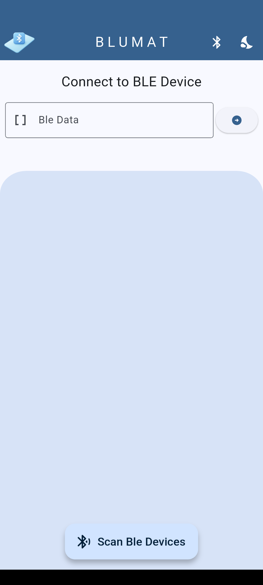
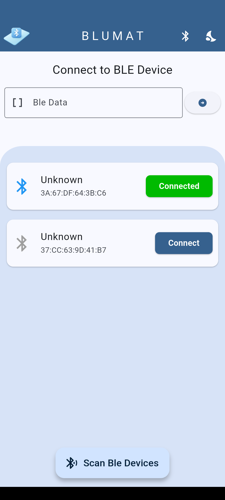
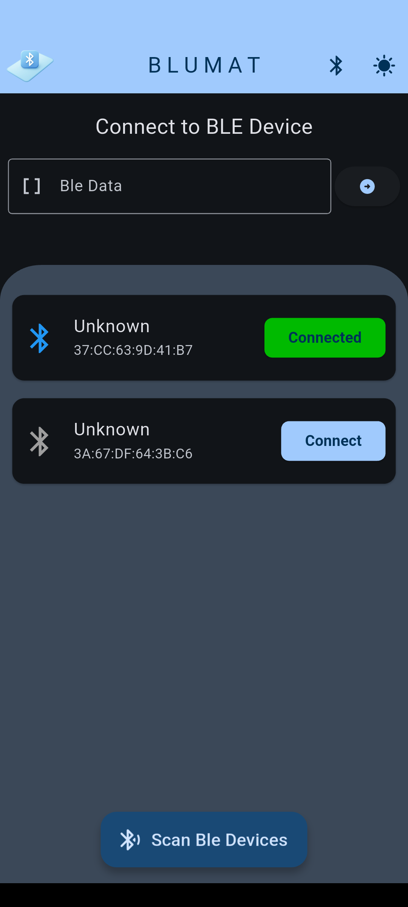
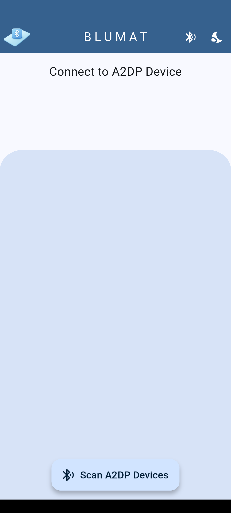
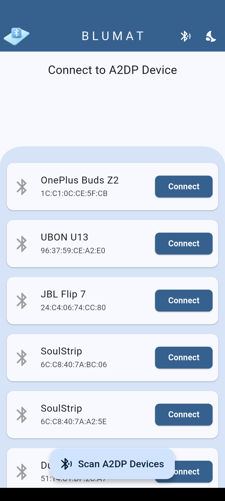
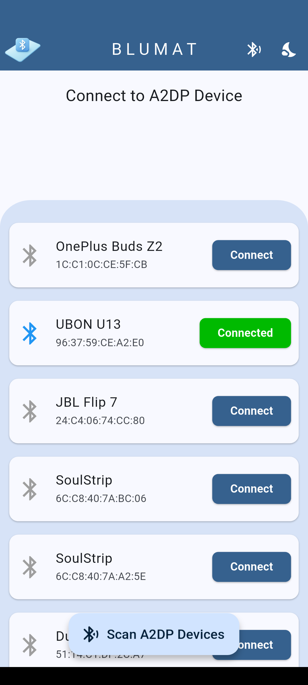

# 🔵 BluMat --- Flutter Bluetooth Integration

BluMat is a Flutter application exploring Bluetooth connectivity through
a combination of **Flutter/Dart and native Android Kotlin**. It includes
separate BLE and A2DP-related components, with Flutter providers and
services coordinating app-side functionality.

The project can serve as a practical reference for developers learning
how a Flutter app can integrate Android-specific Bluetooth
functionality.

## ✨ Features

-   📱 Flutter UI with light and dark theme support.
-   🔵 BLE device scanning and connection flow.
-   🎧 Native Android components for A2DP-related Bluetooth
    functionality.
-   🤖 Kotlin-based Android integration.
-   🌉 Flutter-to-native communication using platform channels.
-   🧩 Separate providers for BLE, A2DP, and general Bluetooth state.
-   🧱 Reusable Flutter widgets for cards and text fields.

> Bluetooth behavior depends on the Android version, device,
> permissions, and capabilities of the connected hardware.

## 🏗️ Project Structure

``` text
BluMat/
├── android/app/src/main/
│   ├── kotlin/com/harshRajpurohit/blu_mat/
│   │   ├── A2dpManager.kt
│   │   ├── A2dpService.kt
│   │   ├── BleManager.kt
│   │   ├── BluetoothManager.kt
│   │   └── MainActivity.kt
│   └── AndroidManifest.xml
├── assets/
│   ├── icon/
│   ├── images/
│   └── screenshots/
├── lib/
│   ├── provider/
│   │   ├── a2dp_provider.dart
│   │   ├── ble_provider.dart
│   │   └── bluetooth_provider.dart
│   ├── screens/homescreen.dart
│   ├── services/bluetooth_service.dart
│   ├── Theme/theme.dart
│   ├── widgets/
│   │   ├── custom_card.dart
│   │   └── generic_text_field.dart
│   └── main.dart
├── pubspec.yaml
└── README.md
```

## 📸 Screenshots

Here are some previews of the BluMat app in action:

| BLE Bluetooth — Light | BLE Device Connected — Light | BLE Device Connected — Dark |
|---|---|---|
|  |  |  |

| Classic Bluetooth — Light | Classic Device Discovery — Light | Classic Device Connected — Light|
|---|---|---|
|  |  |  |

### Main components

-   **`BleManager.kt`** --- Native Android BLE-related implementation.
-   **`A2dpManager.kt` and `A2dpService.kt`** --- Native Android
    A2DP-related components.
-   **`BluetoothManager.kt`** --- Native Bluetooth management component.
-   **`MainActivity.kt`** --- Android entry point for the Flutter app
    and its native integration.
-   **`ble_provider.dart`** --- Flutter-side BLE state and operations.
-   **`a2dp_provider.dart`** --- Flutter-side A2DP-related state and
    operations.
-   **`bluetooth_provider.dart`** --- Flutter-side Bluetooth state
    management.
-   **`bluetooth_service.dart`** --- Flutter Bluetooth service layer.

These descriptions reflect the filenames and folder layout; consult the
source code for exact method behavior.

## 🛠️ Built With

-   [Flutter](https://flutter.dev/)
-   [Dart](https://dart.dev/)
-   [Kotlin](https://kotlinlang.org/)
-   [Android platform
    channels](https://docs.flutter.dev/platform-integration/platform-channels)

See [`pubspec.yaml`](pubspec.yaml) for the project's package
dependencies.

## 🚀 Getting Started

### Prerequisites

-   [Flutter SDK](https://docs.flutter.dev/get-started/install)
-   Android Studio or another compatible Flutter development environment
-   Android SDK and Kotlin support
-   An Android device for Bluetooth testing
-   Compatible Bluetooth hardware for the feature you want to test

### Run the app

1.  Clone the repository:

    ``` bash
    git clone https://github.com/mojit-r/blu_mat.git
    cd blu_mat
    ```
    
2.  Fetch dependencies:

    ``` bash
    flutter pub get
    ```

3.  Connect an Android device, enable Bluetooth, and grant the
    permissions requested by the app.

4.  Run:

    ``` bash
    flutter run
    ```

For Bluetooth testing, prefer a physical Android device. Behavior can
vary across Android versions and manufacturers.

## 🔐 Permissions and Compatibility

Bluetooth permissions vary by Android version. Review
`android/app/src/main/AndroidManifest.xml` and the app's runtime
permission handling before testing or adapting the project.

The native Kotlin implementation is Android-specific; do not assume
these features work on iOS without a separate implementation.

A2DP is an audio streaming profile, not a general-purpose data channel.
Actual behavior depends on the connected device and the implementation
in this repository.

